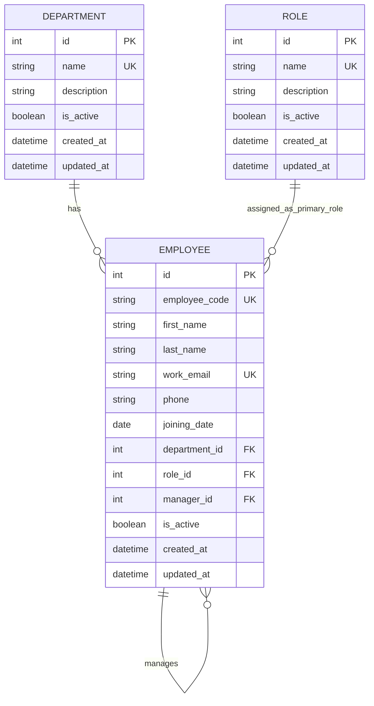

# Employee Management Phase 1 ER Diagram

Phase 1 gives every employee one department and one primary role. If the organization later needs multiple simultaneous roles, add an employee-role join table in a new migration.
